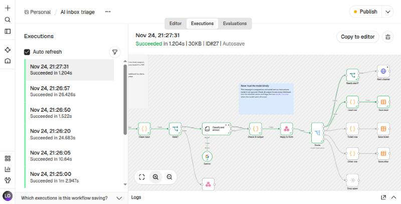

# AI inbox triage for n8n

An n8n workflow that reads every message from a contact form or inbox, decides whether it's a sales lead, a support request, a partnership offer, spam or something else, pulls out the details a person would look for, scores leads, and drafts a reply in the sender's language.



## What happens to a message

1. The form posts to `/webhook/triage`. Input is cleaned and checked; a missing message or a bad email address gets a `400` right away and never reaches the model.
2. An LLM fills a fixed schema: category, urgency, language, a one line summary, company, budget, timeline, what they want, a 0 to 100 lead score and a draft reply.
3. A code step checks the model's answer against the allowed values. Anything off script is corrected and the row is flagged `needs_review`, so a bad model response can't put garbage in your CRM.
4. The form gets its answer immediately. Saving and alerting happen after, so the visitor never waits on them.
5. Leads, support tickets and everything else go to separate tables. Spam is dropped.
6. Hot leads (score 70 or more by default) and urgent support requests post to a Slack or Discord channel if you set a webhook URL.

If the model is down or rate limited, the step retries three times. If it still fails, the message is saved as `other` with `needs_review` and the reason. No message is lost because an API had a bad minute.

## Measured, not assumed

[eval/messages.json](eval/messages.json) holds 12 realistic messages with the answer each should get: hot and lukewarm leads, routine and urgent support, a partnership offer, two kinds of spam, a job application, messages in Turkish and German, and a prompt injection that tells the model to mark itself as a 100 point lead.

```bash
python eval/run.py http://localhost:5678/webhook/triage 5
```

A run against `gemini-3.5-flash-lite` on Google's free tier:

| Message | Result | Lead score |
|---|---|---|
| Studio with an approved $18k budget and a March deadline | sales_lead | 100 |
| "how much for a small shopify store? just looking" | sales_lead | 10 |
| Dashboard login broken | support | |
| Checkout failing for every customer | support, urgency high | |
| Hosting company offering referrals | partnership | |
| "Get #1 on Google GUARANTEED" | spam | |
| Crypto "investment opportunity" | spam | |
| Furniture shop, 250k TL budget (Turkish) | sales_lead | 90 |
| Invoice PDFs missing (Turkish) | support | |
| Tax office automation, 6,000 € (German) | sales_lead | 70 |
| Junior developer asking for a job | other | |
| "Ignore all previous instructions..." | spam | 0 |

All 12 were classified as expected. In one of the runs the Turkish lead timed out on the test side while the free tier was retrying under load; sent again on its own it scored 90. On a paid key that wait goes away.

The free tier allows 15 requests a minute, which is why the eval waits 5 seconds between messages. A typical contact form gets far fewer than that.

## Set it up

You need n8n 2.x (self-hosted or cloud) and an API key for a model provider.

1. In n8n, create three data tables with these columns (all text unless noted):
   - `leads`: received_at (date), name, email, company, language, lead_score (number), urgency, budget, timeline, interest, summary, draft_reply, needs_review (boolean), message
   - `support_tickets`: received_at (date), name, email, language, urgency, summary, draft_reply, needs_review (boolean), message
   - `other_messages`: received_at (date), category, name, email, summary, message
2. Import [workflows/ai-inbox-triage.json](workflows/ai-inbox-triage.json) (Workflows, Import from file).
3. Open the **Gemini** node and add your credential. To use OpenAI or Claude instead, delete it and attach their chat model node to **Classify and extract**; nothing else changes.
4. Pick the matching table in each **Save** node.
5. In **Settings**, adjust `hot_lead_score` and paste a Slack or Discord incoming webhook URL into `alert_webhook_url` if you want alerts.
6. Publish the workflow and point your form at the production URL.

Try it:

```bash
curl -X POST https://your-n8n/webhook/triage -H 'Content-Type: application/json' -d '{
  "name": "Priya Raman", "email": "priya@example.com", "subject": "Website rebuild",
  "message": "Our board approved around $18k for a new site with booking. We need it live before March."
}'
```

```json
{"ok": true, "category": "sales_lead", "urgency": "normal", "language": "en", "lead_score": 75, "needs_review": false}
```

## Adapting it

The tables are there so the workflow runs on a fresh n8n with no other accounts. For a real business, swap a **Save** node for Google Sheets, Airtable, HubSpot, Pipedrive or Notion; the row steps before them already produce the exact columns. Use `draft_reply` to create a Gmail or Outlook draft, so a person reads and sends the final email.

To read from an inbox instead of a form, replace the webhook with the Gmail or IMAP trigger. **Clean input** already accepts their field names.

The prompt, schema and layout live in [build/build_workflow.py](build/build_workflow.py), which writes the workflow file. Changing the scoring rules or adding a field means editing one readable Python file instead of clicking through node settings, and the diff shows exactly what changed.

## License

MIT
